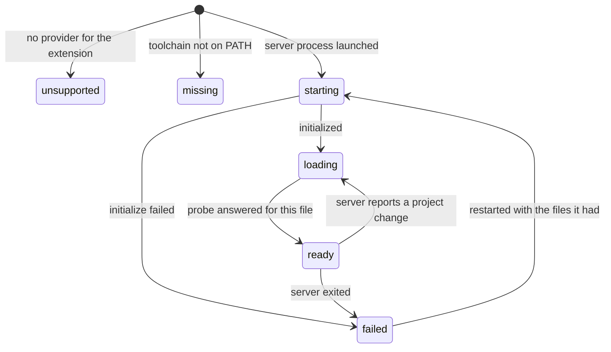

# Completion: design notes

This document records how external completion works and why the editor does not speak to `clangd` or Roslyn itself.

User-facing behavior is in [commands.md](commands.md). Threading is in [processes.md](processes.md).

## Why a session

A check is one process per buffer: standard input is the text, standard output is a JSON array, and the process exits. `clangd` and the C# language server spend their time building an index and a preamble. Starting one for every keystroke would not complete in time. `autocomplete` in a `.crlf` file is the same kind of command string as `syntax`, and the process stays up for the project.

The editor writes one JSON object per line and reads one JSON object per line. `scripts/autocomplete.py` is the only place that speaks LSP. Adding a language means adding one entry to that script's provider list. The popup, the document, and the orchestrator stay as they are.

## Where it runs

`CompletionSession` is moved onto the orchestrator thread with `SyntaxRunner`. `QProcess` is created there. `start`, `request`, and `stop` are queued from the UI thread and return. Every request is one `CompletionRequest`, built by `MainWindow::sendCompletion` from the editor's path, caret, revision, and buffer. The reply signals are queued back, and `MainWindow::applyCompletion` is the only place that fills the popup.

The request carries the buffer. A tool that opened `${file}` would complete the saved copy and miss unsaved edits. A `resolve` does not carry it, because it names a row of a list the script already has. When the session is running in a WSL distro, a `\\wsl.localhost` path is sent as the Linux path (`/home/...`), because the language server is a Linux process and cannot open the Windows UNC path. The session remembers which editor path each of those was, so a reply about `/home/...` is delivered under the path the editor uses. `revision` is `QTextDocument::revision()` at send time. A reply whose id or revision is older than the buffer is dropped. Lists, signatures, and documentation each count their own ids, so asking for one does not cancel another. Switching tabs drops whatever is still on its way.

The session is one `Hold` record shown as `autocomplete` on the Processes page. It stays until the command is turned off, the project changes, or the process exits. Stopping it closes the kill-on-close job and calls `QProcess::kill()` on the orchestrator thread. It does not wait.

## Readiness

The script decides whether a file is ready and says so. The editor keeps what it was told and shows it. It does not work out a file's readiness from the log or from the time that has passed.

Every file the editor names gets a state, and every change of that state is one line on standard output:

```json
{"kind":"state","path":"/src/App/Program.cs","state":"loading","server":"App.csproj","message":"loading Program.cs","triggers":["."," "]}
```

| State | Meaning | Message |
| --- | --- | --- |
| `starting` | The file's server process is being started | `starting App.csproj (12s)`. It repeats every 2 seconds, because OmniSharp sends no progress of its own until initialization is complete |
| `loading` | The server is up and has not answered for this file yet | `loading App.csproj`, then `loading Program.cs`. `waiting for App.csproj` while an empty first answer is asked again |
| `ready` | The server has answered a request about this file | `ready` |
| `unsupported` | No server is configured for the extension | The editor shows `not available for Markdown` |
| `missing` | The toolchain is not installed | `clangd not found`, `No C# language server found` |
| `failed` | The server did not start, exited, or rejected the file | `App.csproj failed to start: ...`, `App.csproj exited`, `Program.cs did not load: ...` |



**What ready means.** After the buffer is sent, the script asks the server for `textDocument/documentSymbol` on that document and waits for the reply. A server handles messages in the order they arrive, so the reply means the open and the change before it have been applied. That is the whole test. It does not depend on diagnostics being published, on a log line, on a log level, or on a timeout. A probe the server rejects ends in `failed` for that file and is tried again on the file's next request.

**The buffer always follows the open.** OmniSharp reads the saved file when it gets `didOpen` and ignores the text sent with it. The script sends `didChange` with the buffer right after, so a file with unsaved edits is completed as it is in the editor from the first request.

**Paths are percent-encoded.** A document is `file:///home/me/My%20App/Program.cs`, which is the form the server uses itself. A path with a space or a non-ASCII character is the same document on both sides.

**Every tab is opened.** When the session starts, each saved editor is sent `"kind": "open"` with its buffer. Restored tabs are included, not only the one in front, so a server is loaded before its tab is selected. A tab opened later is sent when it first comes to the front, and again when it is saved under another name. An `open` has no reply other than the state. A second `open` for the same file says the state again, which is how the editor relearns it after it has cleared what it knew. An `open` that arrives while the process is starting is held and written when it runs.

**A server that exits is started again.** OmniSharp has been seen to exit a moment after `initialize`, as the first file reaches it. Why is not known. The files it had go to `failed` with `App.csproj exited`, the server is started again, and each of those files is opened with its newest buffer. This happens up to twice for exits less than a minute apart. After that the files stay `failed` with `App.csproj exited 3 times` until the session is restarted.

**A project change asks again.** When OmniSharp reports that a project was added or changed, the files it had go back to `loading` and are probed again.

### What the editor shows

The status bar has one field. It is about the tab in front:

| Field | When |
| --- | --- |
| `Autocomplete: ready` | The file's server has answered for it |
| `Autocomplete: starting App.csproj (12s)`, `loading Program.cs` | The state's message |
| `Autocomplete: not available for Markdown` | No server for this language. Nothing is sent for this file |
| `Autocomplete: clangd not found` | The toolchain is missing. Nothing is sent for this file |
| `Autocomplete: App.csproj exited` | The state's message |
| `Autocomplete: not available until the file is saved` | The buffer has no path |
| `Autocomplete: starting` | The session is running and has not reported this file yet |
| `Autocomplete: stopped` | Completion is enabled and the session is not running. Restart Services in View > Processes brings it back |

On a page that is not an editor, such as Processes, the field shows the session's Activity instead. With completion off the field is hidden.

`MainWindow` keeps the states in a map from path to `CompletionFileState` and empties it when the session starts again. `ProcessOrchestrator` knows nothing about completion.

The Activity column on the Processes page is a summary of the servers, written as a `CRLF_STATUS:` line: `servers: 2 ready, 1 starting`. It is followed by the first of any extra notes: `scanning for C# projects`, `analyzing 40/79` or the server's own `$/progress` text, or a missing toolchain.

## Asking

The 100ms timer stays on the editor. It does not kill or start a process. It asks `MainWindow` to queue a request.

- **Ctrl+Space** asks at once.
- **A trigger character** asks for the names that can follow it. The characters come from the server, in the `triggers` of the file's state: `.` and a space for OmniSharp. The request carries `"trigger"`, and the server decides whether that character means anything where it was typed. A space after `new` returns the types that can be constructed. A space anywhere else returns nothing, and the list stays closed.
- **The first letters of a word** ask when no list is open. This is what offers type names where a variable is being declared and enum names where a value is expected. A word that starts with a digit does not ask.
- **Inside parentheses**, every key also asks for the signature.

A letter typed while the list is open does not ask again: the popup keeps the full list and shows the rows that start with the word before the caret, ignoring case. It compares the row's `filterText` when the server sent one, otherwise the label. Backspace narrows or widens that same list. The list belongs to the column its word starts at. It closes when the caret leaves that word: deleting back past its start, moving with the arrow keys, clicking elsewhere, or typing a character that is not part of a name. A list with no row left closes. A file whose state is `unsupported` or `missing` is never asked about, so typing in it sends nothing.

Choosing a row replaces the word. The row's range was measured when the list was asked for, so letters typed since then extend it. Choosing a completion that leaves the caret inside `()` asks for the signature of that call.

## Items

The reply to a completion is `items` and `incomplete`.

Each item has `label`, `data`, `replaceLine`, `replaceColumn`, and `replaceEndColumn`. The rest are left out when they are empty: `detail`, `documentation`, `insert` (when it differs from the label), `kind`, `filterText`, `preselect`, and `additionalEdits`.

`kind` is the language server's item kind as a word: `class`, `struct`, `interface`, `enum`, `enumMember`, `method`, `property`, `field`, `variable`, `keyword`, and the others in the protocol. The popup shows it at the right of the row.

`preselect` marks the row the server expects. The popup opens with that row selected and in view. In `Color c = `, Ctrl+Space selects `Color`, with `Color.Red`, `Color.Green`, and `Color.Blue` under it. After `new `, the declared type is selected. The script tells the server it supports this; whether a row is marked is the server's decision.

`additionalEdits` are edits the server wants made along with the row, such as the `using` for a type from another namespace. They are carried on the item. The editor does not apply them yet.

Rows are sorted by the server's `sortText`, or the label, ignoring case. All of them are sent, up to 1,000. A longer list is cut to the rows that match the word being typed and marked `incomplete`, as is a list the server itself called incomplete. The editor asks for an incomplete list again each time the word changes.

`data` is the script's name for the row, such as `14:3`. The script keeps the server's own rows for the last list. Selecting a row whose documentation is empty sends `"kind": "resolve"` with that `data` and no buffer. The reply fills `detail` and `documentation` on that row. A `resolve` for a list that has since been replaced gets no reply. The list row is the label and `detail`. The selected row shows `documentation` under the list.

The popup is a `QListView` over a model, with one row height for every row, so the view measures and paints only the rows on screen. A list of every type in scope costs no more to show than a short one.

## Signatures

A signature request sets `"kind": "signature"`. The reply is `signatures`, each with `label`, `parameters`, and `active`. Every overload is included. The editor draws one of them above the caret on the theme's completion panel (`completionBackground`, `completionForeground`, `completionBorder`) and colors `parameters[active]` with `completionActive`. When there is more than one, the hint starts with the count, `2 of 5`. Ctrl+Up and Ctrl+Down move through the overloads. They do not move the caret or the completion list. A theme that omits those keys gets a panel that stays readable on its editor background. An empty `signatures` array hides the hint. The completion list uses the same panel colors.

## The script

`scripts/autocomplete.sh` execs `python3` on `scripts/autocomplete.py`.

**Providers.** `main()` parses each line and looks the file's extension up in a list of providers. A provider returns a route: the server's key, its command line, its working directory, the language id, and the label shown in states. C and C++ use one `clangd` for the working directory, through `single_server`. A language with one server for the whole project is one more `single_server` line. C# has its own provider, because it keeps one server per project. An extension with no provider is `unsupported`. A provider whose program is not on `PATH` is `missing`. Neither stops completion for the others.

**C# projects.** The editor does not look for a C# project. The script does, once, when the session starts. It walks the completion working directory and remembers every `.csproj`, skipping `bin`, `obj`, `.git`, `node_modules`, and `.vs`. A file belongs to the project whose directory is the longest prefix of its path. A file opened from outside that directory still belongs to a project when a parent directory contains a `.csproj`. Each project gets its own server, started on the first request for one of its files and kept for the rest of the session. C# uses `OmniSharp -lsp` when that is on `PATH`, otherwise `Microsoft.CodeAnalysis.LanguageServer.dll` from the newest .NET SDK. OmniSharp is started with `-s` pointing at that project's directory, which is the path it accepts, so a sibling project is not loaded. A `ProjectReference` is still loaded by the server that owns the referencing project.

A `.cs` file that belongs to no project uses one shared server with no solution. Those loose files see each other and do not join a project server. The Processes log shows `using /src/App/App.csproj` or `loose file` while that server is starting. Reload on the `autocomplete` row starts `autocomplete.py` again, so an edit to it takes effect without reopening the project. OmniSharp asks the client for configuration and progress tokens before it finishes loading a project. The script answers those, and it copies OmniSharp's own log into the Processes log.

`compile_commands.json` stays the C and C++ server's concern.

**One worker per server.** Every server (`clangd`, each C# project, the loose files) has a queue and a thread, so a project that is loading does not hold up a loose file or a C++ file. Output from those threads goes through one lock, so lines are never interleaved.

**Only the newest request is answered.** Typing while a server is loading queues a request per keystroke. Before it works, a worker takes everything waiting and keeps the newest `completion`, the newest `signature`, the newest `resolve`, and the newest `open` of each file. The others get no reply; the editor would drop them anyway, since their ids are older. The request kept carries the full buffer, so the server's copy of the document stays current. The log says how many were skipped.

**An empty or failed first answer is asked again.** Within a server's first 60 seconds, a completion that comes back empty or throws is asked again after a second, up to 3 times. A signature is asked again only when it throws. A completion after a space is not asked again, because a space is answered with nothing most of the time. A newer request in that worker's queue ends the wait. After the retries the reply is an empty item list or an empty signature list, and the exception stays in the log.

**Less startup work.** OmniSharp runs with `-l Error` and `RoslynExtensionsOptions:AnalyzeOpenDocumentsOnly=true`. The error level drops the warning OmniSharp writes for each notification it holds back during startup. Analyzing open documents only skips the whole-project error pass that delays the `initialize` reply. The .NET SDK language server is started as before.

**Unchanged text is not sent again.** `didChange` is skipped when the buffer is the same text the server was last given. The warm-up `open` and the first completion often carry that same buffer.

**One timing line.** Each handled request logs once: `completion test.cs 8:16: 18 items in 140ms`.

**Quieter OmniSharp.** `window/logMessage` is logged only for errors and warnings. `--verbose`, or `CRLF_AUTOCOMPLETE_VERBOSE=1`, keeps information messages too and starts OmniSharp at `-l Information` instead of `-l Error`. `scripts/autocomplete.sh` forwards its arguments, so the command in the `.crlf` file can be `scripts/autocomplete.sh --verbose`.
