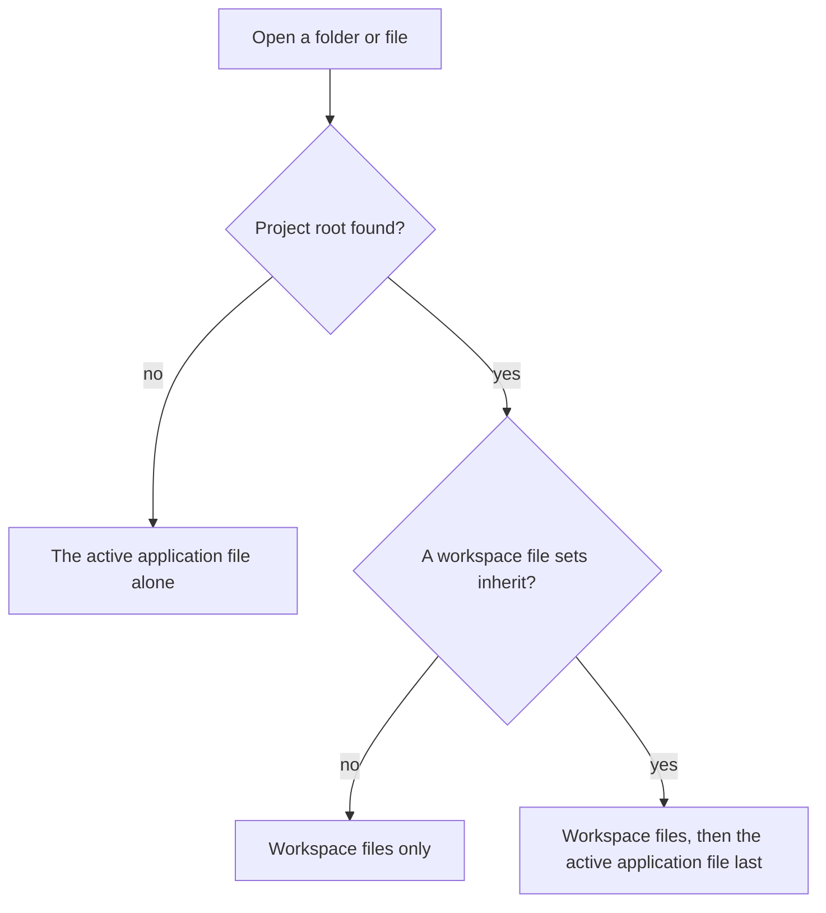

# The .crlf files

`.crlf` is a file extension and a folder name. A project's settings are every `<name>.crlf` file in its root, merged into one. The folder named `.crlf` beside them holds what the project keeps for the editor and its agents. The editor has settings of its own in an application file, `application.crlf` unless another is chosen, which apply where a project has none or asks for them.

Each file is JSON. The parser in `io/ProjectCommands.cpp` is the list of keys that do anything, and `io/ProjectMerge.cpp` is how several files become one. A key that is not in that list is kept when a file is rewritten and is otherwise ignored.

Menus, variables, and how a command runs are in [commands.md](commands.md). Checks are in [diagnostics.md](diagnostics.md). Completion is in [autocomplete.md](autocomplete.md). Definition links are in [navigation.md](navigation.md). Source control is in [git.md](git.md). The Agent panel is in [agent.md](agent.md), and the shipped agent's tools and code index are in [agent-tools.md](agent-tools.md).

## Layout

```
project/                       a workspace
  workspace.crlf               settings (any name with the .crlf extension)
  local.crlf                   optional, merged with the others
  application.crlf             optional: the workspace's copy of the application settings, merged last
  .crlf/
    data/                      the agent's code index, and its own .gitignore
    rules/                     agent rule files
    keys/                      API key files
    scripts/, temp/            free for the project's own use

%APPDATA%\CRLF\CRLF\           the application folder
  application.crlf             settings for every folder: the shipped scripts and agents, set up
  blank.crlf                   application settings that set nothing
  <name>.crlf                  any others the user adds; one of them is the active file
  .crlf/
    scripts/                   the user's own scripts, shared by every workspace
    keys/                      API key files shared by every workspace
    rules/                     agent rules shared by every workspace

<install folder>\scripts\      shipped scripts, refreshed by each upgrade
```

The editor reads the `<name>.crlf` files and nothing else in this layout. It creates the application folder's `.crlf` subfolders, and creates a workspace's `.crlf` folder only for [Copy Application Files to Workspace](#copy-application-files-to-workspace). The reference agent creates `.crlf/data` and reads `.crlf/rules`; see [agent-tools.md](agent-tools.md). `.crlf/keys`, `.crlf/scripts`, and `.crlf/temp` are conventions: a command names them by path. Payload files for `${buffer}` and `${terminal}` stay in the system temp folder.

## Which files are in use

The search starts at the folder the explorer is scoped to. When no folder is scoped, it starts at the directory of the focused document. It walks parent folders and stops at the drive root, or at the distro root of a `\\wsl.localhost` path. The first folder that holds at least one `<name>.crlf` file is the project root. The folder named `.crlf` is not a file and does not count. The application folder is never a project root; the walk passes it.



- **No project root.** The active application file is used alone.
- **Workspace files without `inherit`.** The application settings are not read.
- **`inherit` set.** The active application file is merged after the workspace files, whole or limited to the keys `inherit` lists. See [Application settings](#application-settings).

The workspace files are taken in file-name order, ignoring case, so `local.crlf` is read before `workspace.crlf`. The order matters because the earlier file wins; see [Merging the files](#merging-the-files).

One name is an exception. A file named `application.crlf` in a project root is the workspace's own copy of the application settings, put there by [Copy Application Files to Workspace](#copy-application-files-to-workspace). It is the base the workspace's other files adjust, so it is read after all of them, although its name sorts first. A root with `application.crlf`, `local.crlf`, and `workspace.crlf` is read as `local.crlf`, `workspace.crlf`, `application.crlf`. It is a workspace file like the others: it applies without `inherit`, and the application folder's file is still merged after it only when `inherit` is set.

The files are read again when the explorer folder changes, when the current tab changes, when a document is saved, when a file in use changes on disk, when a file is added to the project root or removed from it, when a virtual folder or an icon mapping is saved from the UI, and after Copy Application Files to Workspace. The read runs off the UI thread. A newer read replaces an older one that has not been applied yet.

The watcher holds the settings files in use, the files listed under `watch` by `syntax` and `autocomplete`, and the project root folder. A change to one of the files restarts the services. A change to the folder reloads the settings and restarts a service only when its own settings changed. The active application file is watched while it is in use. The application folder itself is not watched, because the session file is rewritten there every 30 seconds.

A file that is not JSON, or that is neither an array nor an object, is skipped. The status bar says "Couldn't read" and the file's name, such as "Couldn't read local.crlf", and the other files still apply. The file stays watched, so fixing it reloads the project. When every workspace file is unreadable, nothing applies; the application file is not used in their place.

## Merging the files

The files are merged as JSON, in order, and the result is read as one file. The earlier file wins.

| Key | How the files combine |
|---|---|
| `commands`, `agents` | Joined in file order. An entry whose `name` was already seen is dropped, so the first definition wins |
| `groups` | Joined the same way. Two groups are the same when `name` and `path` are both the same, as written |
| `hide` | The union of every file's list |
| `icons` | `theme` comes from the first file that sets it. `rules` are joined |
| `indent` | `style`, `size`, and `keep` each come from the first file that sets them. `types` are joined, and the first matching type still wins |
| Any other key | Taken whole from the first file that has it. That covers `syntax`, `autocomplete`, `git`, `navigation`, `externalNavigation`, `unlimitedLog`, and every key the editor does not know |
| `inherit` | Read from the first workspace file that has it. It is not part of the result |

A bare array file is a list of commands, and merges as `{ "commands": [...] }`.

Two files in one project root. `local.crlf` is one developer's own and is left out of git; `workspace.crlf` is shared.

`local.crlf`:

```json
{
  "commands": [
    { "name": "Build", "command": "cmake --build build --parallel 16" }
  ],
  "hide": ["scratch"],
  "indent": { "size": 2 },
  "syntax": { "enabled": false }
}
```

`workspace.crlf`:

```json
{
  "commands": [
    { "name": "Build", "command": "cmake --build build" },
    { "name": "Test", "command": "ctest --test-dir build" }
  ],
  "hide": ["build", "*.log"],
  "indent": { "style": "spaces", "size": 4, "keep": true },
  "syntax": { "enabled": true, "command": "./scripts/syntax.sh \"${file}\"" }
}
```

What applies:

```json
{
  "commands": [
    { "name": "Build", "command": "cmake --build build --parallel 16" },
    { "name": "Test", "command": "ctest --test-dir build" }
  ],
  "hide": ["scratch", "build", "*.log"],
  "indent": { "size": 2, "style": "spaces", "keep": true },
  "syntax": { "enabled": false }
}
```

Build is `local.crlf`'s, and Test is added from `workspace.crlf`. `hide` has both lists. `indent` takes `size` from `local.crlf` and the fields it left out from `workspace.crlf`. `syntax` is taken whole from `local.crlf`, so checking is off and the shared command is not used: a key of that kind is not blended.

A type under `indent.types` takes the fields it leaves out from the merged standard rule, not from the standard rule of the file it was written in.

## Application settings

An application file holds the settings a user wants in every folder: commands, agents, an indent rule. The application files live in the application folder, `%APPDATA%\CRLF\CRLF`, beside the saved session. One of them is active, and that is the one this document means by "the application file". Each takes the same keys as a workspace file, except that `inherit` means nothing in it.

The application folder also has a `.crlf` folder with `scripts`, `keys`, and `rules`, for the files those settings use. `${appDir}` is that folder's path in a command.

### The shipped files

Two application files ship with the editor.

| File | What it sets |
|---|---|
| `application.crlf` | The shipped scripts, set up. It is the active file on a new install |
| `blank.crlf` | Nothing. Choose it to run with no application settings |

`application.crlf` as shipped (`resources/default.crlf` in this repository) has:

- **Four agents**, Claude, GPT, Grok, and Local, each running the shipped `${programDir}/scripts/agent/crlf_agent.py`. Each has a `windows` command line that starts `python` and a `wsl` one that starts `python3`. Claude, GPT, and Grok read their key from `${appDir}/keys/anthropic`, `${appDir}/keys/openai`, and `${appDir}/keys/xai`; Local talks to Ollama and needs none. Each reads the workspace's rules and then the application's. An agent works once its key file exists. The model names are examples to replace with the ones the account offers.
- **`syntax` and `autocomplete`**, running the shipped `syntax.sh` and `autocomplete.sh` with `bash`. The scripts are bash scripts, so only a `wsl` command line is given: they run for a project inside a WSL distro, and in a Windows folder neither starts. Neither lists its scripts under `watch`, which does not take variables; Reload on the Processes page reads an edited script again.
- **No menu commands.**

Each build and each install puts both files beside the program. A run copies each one the application folder does not have into it, and creates the three `.crlf` folders. A file already in the application folder is never replaced, so an edit survives an upgrade, and an upgrade does not bring a newer shipped version of a file that is already there. To get the shipped `application.crlf` again, delete or rename the one in the application folder and start the editor.

**Settings from an earlier version.** Before the application folder, these settings were a file named `.crlf` beside the program. On the first run with the application folder, that file is copied in as `previous.crlf` and made the active file, so the same settings keep applying. `application.crlf` is there to switch to. An old file that was never edited, and so still holds only the empty command list it shipped with, is left behind, and `application.crlf` is active. A relative path in `previous.crlf` no longer resolves against the program folder; see [Paths](#paths). A folder that an earlier build already filled keeps the `application.crlf` it was given then, which holds those earlier settings and not the shipped scripts.

### Choosing the active file

View > Edit Defaults > Application Settings lists every `<name>.crlf` file in the application folder, with the active one checked. Choosing another makes it active and reads the project again. Any file placed in that folder appears in the list, so a user can keep several setups and switch between them.

- **Edit Active File** opens it in a tab.
- **Open Application Folder** shows the folder in File Explorer.

The choice is remembered by file name. When the chosen file is no longer there, `application.crlf` is used.

### inherit

A workspace replaces the application settings unless one of its files sets `inherit`. The value is read from the first workspace file, in name order, that has the key. A later file's `inherit` is ignored.

| Value | What is taken from `application.crlf` |
|---|---|
| `true` | Every key |
| An array of key names | Those keys |
| `false`, an empty array, or left out | Nothing |

Whatever is taken is merged last, by the rules above. A list from `application.crlf` follows the workspace's, the workspace wins a shared name, and a key the workspace already has is the workspace's.

Everything:

```json
{
  "inherit": true,
  "commands": [
    { "name": "Build", "command": "cmake --build build" }
  ]
}
```

The project has its Build command, then every command in `application.crlf` that is not named Build, and every other application setting the project does not set itself.

Some keys:

```json
{
  "inherit": ["agents", "indent"],
  "commands": [
    { "name": "Build", "command": "cmake --build build" }
  ]
}
```

The project takes the user's agents and indent rule. The user's commands, hidden names, and the rest are left out.

### Paths

- A relative `cwd`, `watch`, or group `path` in a workspace file resolves against the project root.
- The same fields in `application.crlf` resolve against the project root too, when the file is inherited. An application command with `"cwd": "build"` runs in each project's own `build` folder.
- With no project root, they resolve against the folder the explorer is scoped to, or against the application folder when no folder is scoped. The application's virtual folders are shown relative to the scoped folder.
- `${project}` is the project root. It is empty when only `application.crlf` applies.

An application entry reaches its script and its key through variables, because it has no folder of its own to be relative to:

```json
{
  "agents": [
    {
      "name": "GPT",
      "command": {
        "windows": "python \"${programDir}/scripts/agent/crlf_agent.py\" --provider openai --model gpt-5 --api-key-file \"${appDir}/keys/openai\" --rules .crlf/rules --rules \"${appDir}/rules\"",
        "wsl": "python3 \"${programDir}/scripts/agent/crlf_agent.py\" --provider openai --model gpt-5 --api-key-file \"${appDir}/keys/openai\" --rules .crlf/rules --rules \"${appDir}/rules\""
      }
    }
  ]
}
```

The agent is the shipped one in the install folder. Its key is `%APPDATA%\CRLF\CRLF\.crlf\keys\openai`. It reads the workspace's rules first and the application's second; naming `--rules` replaces the default folder, so both are named. Its index goes to `.crlf/data` in the working directory, which is the project root. The model name is an example. The `command` object and what `${appDir}` becomes inside a distro are under [Windows and WSL](#windows-and-wsl).

## The legacy .crlf file

Earlier versions used one file named exactly `.crlf`. That name now belongs to the folder, and a folder cannot be created while a file has the name. When a project root holds such a file, loading the project renames it:

- to `workspace.crlf`, or
- to `legacy.crlf` when the root already has a `workspace.crlf`. `legacy.crlf` sorts first, so it wins over `workspace.crlf` as the old file did.

The status bar says "Renamed .crlf to workspace.crlf" or "Renamed .crlf to legacy.crlf", and a tab that had the file open follows it. If the rename fails, as in a read-only folder, the file is read under its old name and the rename is tried again at the next load.

Folders from before this layout are not moved. An old `.crlf-data` folder is not read, so the index is built again in `.crlf/data`, and the old folder can be deleted. Rule files in `.crlf-rules` have to be moved to `.crlf/rules` by hand, and key files to wherever the command names them.

## Saving from the editor

New Virtual Folder, the other virtual-folder actions, and View > File Icons > Templates write `groups` and `icons` into a workspace file.

- The first workspace file that has the key receives the new value. The later files lose the key, so one file owns it afterwards.
- When no file has the key, `workspace.crlf` in the project root receives it and is created when absent. With no project root, the folder is the one the explorer is scoped to.
- A folder that had no settings file was running on `application.crlf` alone. The `workspace.crlf` created there also sets `"inherit": true`, so the application's commands, agents, and other settings keep applying.
- `application.crlf` is never written. An entry that came from it and was not changed is left out of the workspace file. An inherited entry that was changed is written, and then wins over the application's.
- Removing an inherited virtual folder or icon rule in the UI does not last: the entry is still in `application.crlf`, so the next load brings it back. Remove it there, or stop inheriting that key.
- A value that ends up empty removes the key instead of writing an empty list.

The write produces the object form. A bare array becomes an object whose `commands` array is the old list. Other keys in the file are left as they were. When the file to write is not JSON or cannot be written, nothing changes and the status bar says "Couldn't write the workspace settings".

## Copy Application Files to Workspace

File > Copy Application Files to Workspace gives the scoped folder its own copy of the application setup. It is enabled while the explorer is scoped to a folder. Use it to make a workspace self-contained: a project whose settings and scripts are edited and committed with it, or a project in a WSL distro that has drive mounting turned off.

A dialog names the folder and has one check box, Replace existing files, which is off each time the dialog opens. Copy starts the copy; Cancel closes the dialog.

| What | Copied from | Into |
|---|---|---|
| Application settings | The active application file, whatever its name | `application.crlf` in the folder's root |
| The workspace's own settings | Created empty, only when the folder has no other `<name>.crlf` file | `workspace.crlf` |
| Scripts | The install folder's `scripts`, then the application's `.crlf/scripts` | `.crlf/scripts/` |
| Rules | The application's `.crlf/rules` | `.crlf/rules/` |
| Keys | Never copied | |

- **The copied `application.crlf`** is the text of the active application file with three paths replaced: `${programDir}/scripts` and `${appDir}/scripts` become `.crlf/scripts`, and `${appDir}/rules` becomes `.crlf/rules`. The copy then runs the copied scripts. `${appDir}/keys` is left as written.
- **How the two files combine.** `workspace.crlf` is read first and `application.crlf` after it, as [Which files are in use](#which-files-are-in-use) describes. Put the workspace's own settings in `workspace.crlf`; what it sets wins, and the copy supplies the rest. Neither sets `inherit`, so the application folder's file no longer applies to this folder.
- **What the replacement misses.** Only those three spellings, with forward slashes, are replaced; `${programDir}\\scripts` is not. The new paths are relative to the working directory, so an entry with its own `cwd` no longer finds its script. Edit such an entry by hand.
- **`workspace.crlf` and the workspace's other settings files** are never replaced or edited, with the box on or off.
- **An application script replaces a shipped one** of the same relative path. Folders named `__pycache__` are not copied.
- **Replace existing files off.** An `application.crlf`, script, or rule file already in the workspace is skipped.
- **Replace existing files on.** Those files are overwritten with the application's copies. A file only the workspace has is left alone. Nothing is deleted.
- **Keys stay behind** because a workspace is usually a git repository, and a copied key could be committed.

The copy runs off the UI thread, as the Processes row Copy Application Files. When it ends, the status bar says "Copied 6 files, replaced 0, skipped 1", with ", couldn't write 2" added when the file system refused a file, and the project reloads. The two settings files count. `workspace.crlf` is copied when it was created and skipped when the folder already had settings of its own.

The copies are a snapshot. A later upgrade refreshes the shipped scripts in the install folder, not the workspace's copies. Running the command again with Replace existing files brings them up to date.

## Windows and WSL

A working directory under `\\wsl.localhost` or `\\wsl$` runs its command through `wsl.exe` in that distro. Any other Windows directory runs through `cmd.exe /d /s /c`. One `application.crlf` serves both, in three ways.

**The `command` object.** `command` is a string, or an object with `windows` and `wsl`. A working directory inside a distro takes `wsl`; any other takes `windows`. A string serves both. This holds for `commands`, `syntax`, `autocomplete`, and `agents`. A side that is left out is an empty command: the entry is skipped for a command or an agent, and a service does not start.

```json
{
  "name": "Lint",
  "command": { "windows": "python tools\\lint.py \"${file}\"", "wsl": "python3 tools/lint.py \"${file}\"" }
}
```

**Path variables.** When a command runs in a distro, `${file}`, `${fileDir}`, `${project}`, `${folder}`, `${buffer}`, `${terminal}`, `${programDir}`, and `${appDir}` are given as Linux paths, and `${cwd}` is the Linux working directory. A path inside the distro loses its `\\wsl.localhost\<Distro>` prefix. A path on a Windows drive becomes the drive's mount, `/mnt/<drive>/...`, so `${appDir}` is a path such as `/mnt/c/Users/me/AppData/Roaming/CRLF/CRLF/.crlf`. The other variables are not changed. This depends on WSL mounting the Windows drives, which it does by default.

**Shared scripts and keys.** Because of those mounts, the shipped scripts under `${programDir}/scripts`, the user's scripts under `${appDir}/scripts`, and the key files under `${appDir}/keys` are read from the Windows side by both environments. Nothing is copied into a distro. With drive mounting turned off, use [Copy Application Files to Workspace](#copy-application-files-to-workspace) and keep the key files inside the distro.

**Line endings.** A `.gitattributes` rule in this repository keeps `*.sh` at LF, so the shipped shell scripts run in `bash` from a Windows checkout or install.

**Installed separately in each environment.** The editor shares files, not programs. Each environment needs its own interpreter (`python` on Windows, `python3` in most distros), its own Python packages installed with that environment's `pip`, and its own tools such as `rg`, `git`, `clang`, and `clangd`.

None of this section has been run inside a WSL distro. The conversion and the choice between `windows` and `wsl` are covered by `ProjectTests`.

## Two shapes

A bare array is a list of commands and nothing else.

```json
[
  { "name": "Build", "command": "cmake --build build", "cwd": "build" }
]
```

An object is the full file. `commands` is the same list. Every other key below is read only from the object. Putting `indent`, `hide`, `syntax`, `autocomplete`, `agents`, or `git` next to a bare array does not parse: a bare array has no place to put them.

```json
{
  "inherit": false,
  "commands": [],
  "groups": [],
  "hide": [],
  "icons": {},
  "indent": {},
  "navigation": true,
  "externalNavigation": true,
  "syntax": {},
  "autocomplete": {},
  "agents": [],
  "unlimitedLog": false,
  "git": {}
}
```

| Key | Type | When it is left out | Section |
|---|---|---|---|
| `commands` | array of objects | No menu commands | [Commands](#commands) |
| `groups` | array of objects | No virtual folders | [Virtual folders](#virtual-folders) |
| `inherit` | `true`, or an array of key names | `application.crlf` is not merged in | [inherit](#inherit) |
| `hide` | array of strings | No name is hidden | [Hidden names](#hidden-names) |
| `icons` | object: `theme` string, `rules` array of objects | View > File Icons decides | [Icons](#icons) |
| `indent` | object: `style`, `size`, `keep`, `types` array of objects | One tab character, four columns wide | [Indent](#indent) |
| `navigation` | boolean | `true` | [Navigation](#navigation) |
| `externalNavigation` | boolean | `true` | [Navigation](#navigation) |
| `syntax` | object: `enabled`, `command`, `cwd`, `watch`. Or a boolean | Off | [Syntax and autocomplete](#syntax-and-autocomplete) |
| `autocomplete` | object: `enabled`, `command`, `cwd`, `watch`. Or a boolean | Off | [Syntax and autocomplete](#syntax-and-autocomplete) |
| `agents` | array of objects: `name`, `command`, `cwd`, `watch`, `permissions` | The Agent panel has nothing to start | [Agents](#agents) |
| `unlimitedLog` | boolean | `false` | [Process logs](#process-logs) |
| `git` | object: `enabled`, `depth`. Or a boolean | Off | [Source control](#source-control) |

A value of the wrong type is read as if the key were left out. JSON has no comments, so this document is where the files are explained.

`workspace.crlf` at the root of this repository uses every key except `inherit` and is the file CRLF reads when this folder is open. Its `syntax` and `autocomplete` entries carry the right commands and are switched off, because the scripts need `bash` and a C++ toolchain (`clang`, `clangd`) that a Windows checkout does not have.

## Commands

Each entry needs `name` and `command`. An entry missing either is skipped. A second entry with the same `name` is skipped, in the same file or in a later one. The name is the menu label, the process name, and the output log.

| Field | Meaning |
|---|---|
| `name` | Required. Identifies the command |
| `command` | Required. Shell command, as a string or as an object with `windows` and `wsl` (see [Windows and WSL](#windows-and-wsl)). `${name}` is filled in when the process starts |
| `cwd` | Working directory, relative to the project root (see [Paths](#paths)). The default is that folder. Variables are not filled in here |
| `menu` | Menu path. A string splits on `/` and `\`. An array does not split, so one entry can contain a slash. Empty parts are dropped. The default is Run |
| `key` | A function key from F1 through F35, with no modifiers. Anything else is ignored. The first command to claim a key keeps it |
| `output` | `editor` sends the focused editor's text to the process and, on exit 0, replaces that editor. Any other value keeps both streams in the output panel |

```json
"commands": [
  {
    "name": "Format",
    "command": "clang-format --assume-filename=\"${fileName}\"",
    "output": "editor",
    "menu": "File"
  },
  {
    "name": "Build",
    "command": "cmake --build build",
    "cwd": "build",
    "menu": ["Tools", "Build"],
    "key": "F5"
  }
]
```

Format replaces the focused editor and does not write the file. Build runs in the `build` directory under the project root and sits on Tools, then Build. F5 starts it. A second `"key": "F5"` later in the merged list is ignored.

`${name}` matches letters only, as in `${file}`. `${file-name}` is not a variable. A name this program does not know is left in the string for the shell. The names are listed in [commands.md](commands.md). `${buffer}` and `${terminal}` are paths to files written for that launch: the focused editor's text, including unsaved edits, and the current terminal's plain text. The same substitution is used for `syntax` and `autocomplete`.

On Windows, a working directory under `\\wsl.localhost` or `\\wsl$` runs the command through `wsl.exe` in that distro, and the path variables are Linux paths there. Any other Windows directory runs through `cmd.exe /d /s /c`. See [Windows and WSL](#windows-and-wsl).

## Virtual folders

`groups` adds folders in the explorer that do not exist on disk. A file is claimed by the first group, in merge order, whose pattern matches its name in that directory. Directories are never claimed.

| Field | Meaning |
|---|---|
| `name` | Required. The label. A group with an empty name is skipped |
| `files` | Names to fold in. A pattern containing `*` or `?` is a wildcard. Any other pattern is an exact name. Matching ignores case |
| `icon` | Folder name passed to the file-icon theme. The default is `name` |
| `path` | Folder under the project root. Empty, `.`, and `./` mean the root itself |
| `recursive` | Also apply the group in subfolders of `path`. The default is false, so the group exists only in `path` itself |
| `showIfEmpty` | When false (the default), the folder is omitted wherever it has no matching files |

```json
"groups": [
  {
    "name": "Configuration",
    "icon": "config",
    "path": "src",
    "recursive": true,
    "files": [".gitignore", "package.json", "*.config.js"]
  },
  {
    "name": "Notes",
    "showIfEmpty": true,
    "files": ["TODO.md", "NOTES.md"]
  }
]
```

Configuration appears in `src` and in its subfolders, and only where one of those names is present. `app.config.js` matches the wildcard. Notes is at the project root, and it stays visible even when both files are missing. A file that matches both groups lands in Configuration, because that group is written first.

## Hidden names

`hide` is a list of file and folder names. A pattern containing `*` or `?` is a wildcard. Any other pattern is an exact name. Matching ignores case and uses the name, not the path.

The explorer drops a matching row. The definition scan of the scoped folder also skips a matching name, so a hidden directory is not walked for Ctrl+click. That scan already skips directories whose names start with `.` and a directory named `node_modules`, whether or not they are in `hide`.

```json
"hide": ["node_modules", "dist", "*.log", "bin", "obj"]
```

No name is built into the list. The `.crlf` folder, where the reference agent keeps its code index, is not hidden by name: it is a dot folder, so the definition scan and the search for git repositories skip it, and the explorer hides it while Hide Dot Folders is on. The index is described in [agent-tools.md](agent-tools.md#what-appears-under-crlfdata).

Hide Dot Folders is a view setting on the explorer's menu. It hides directories whose names start with `.` and leaves files visible, including dot files and the `<name>.crlf` files. It is not a key in these files.

## Icons

`icons` selects the file-icon theme for this project and adds mappings. `theme` is the name of an installed theme, such as `Seti`. Leaving it out keeps View > File Icons. An empty theme and no rules removes the object the next time the mappings are saved.

Each rule needs `kind`, `pattern`, `from`, and `icon`. A rule missing any of those is skipped.

| Field | Meaning |
|---|---|
| `kind` | `extension`, `file`, or `folder`. `directory` is read as `folder` |
| `pattern` | Exact name, or a wildcard when it contains `*` or `?`. `key` is used when `pattern` is empty |
| `from` | Installed theme the glyph is copied from |
| `icon` | Key in that theme |
| `iconOpen` | Expanded folder glyph. Empty keeps `icon` |

```json
"icons": {
  "theme": "Seti",
  "rules": [
    { "kind": "extension", "pattern": "*.test.js", "from": "Seti", "icon": "javascript" },
    { "kind": "file", "pattern": "readme.md", "from": "Seti", "icon": "readme.md" },
    { "kind": "folder", "pattern": "src*", "from": "Seti", "icon": "config", "iconOpen": "folderExpanded" }
  ]
}
```

The same folder rule can be written with `"kind": "directory"` and `"key": "src*"` instead of `pattern`. A rule that leaves out `from` or `icon` is dropped.

## Indent

`indent` is the fallback for Tab when the lines around the cursor do not show an indentation. With no `indent` key, Tab inserts one tab character four columns wide.

| Field | Meaning |
|---|---|
| `style` | `spaces` or `tab`. Any other string leaves the style already in effect |
| `size` | Spaces inserted by a spaces-style Tab, and the column width of a tab character. A value below 1 is ignored |
| `keep` | Enter copies the current line's leading whitespace. A blank line copies the prior non-blank line. A line with no indent stays at column zero. The default is false |
| `types` | Per-extension overrides. Each entry has `extensions` plus any of the fields above |

A type inherits `style`, `size`, and `keep` from the standard rule, then applies the fields it sets. The first matching type wins. The match is the file's suffix without the dot, compared without case. A file with no suffix is matched on its whole name, so `Makefile` needs `makefile`. An entry of `.py` does not match `py`.

Tab itself prefers the whitespace already on the current line, or on the prior line when the current line is not indented. It stops at the first line that has text and no indent. A tab in that whitespace inserts a tab. Spaces insert the shallowest space run in that walk. The rule in this file is used only when that walk finds no indent. Shift+Tab removes one such level.

```json
"indent": {
  "style": "spaces",
  "size": 4,
  "keep": true,
  "types": [
    { "extensions": ["py"], "style": "spaces", "size": 4 },
    { "extensions": ["go", "makefile"], "style": "tab", "size": 4, "keep": true },
    { "extensions": ["json"], "keep": false }
  ]
}
```

A `.py` file uses four spaces. A `Makefile` uses a tab four columns wide, matched on the file name because it has no suffix. A `.json` file inherits four spaces and does not copy indent on Enter. A `.cs` file is not listed, so it uses the standard rule: four spaces, and Enter keeps the prior line's indent.

## Navigation

`navigation` turns Ctrl+hover and Ctrl+click definition links on or off. Missing, or `true`, keeps them. `false` stops the scan of open files and of the scoped folder.

`externalNavigation` turns links into `node_modules` on or off, including package imports, stylesheet names the project does not define, and Tailwind theme lookups. Missing, or `true`, keeps them. `false` leaves those names as plain text. Project definitions still link.

Both keys are read only from the object form. A bare array leaves both on.

```json
"navigation": true,
"externalNavigation": false
```

Ctrl+click still opens a definition in the project. A name imported from a package stays plain text and is not read from `node_modules`.

## Syntax and autocomplete

`syntax` and `autocomplete` use the same object. Leaving the key out leaves that feature off. `false` does the same.

| Field | Meaning |
|---|---|
| `enabled` | Must be `true` for the feature to run. An object that omits it is off |
| `command` | Shell command, as a string or as an object with `windows` and `wsl`. Required in practice: an enabled entry with an empty command does not start |
| `cwd` | Working directory, relative to the project root. The default is that folder |
| `watch` | Array of file paths, relative to `cwd`. Saving one of them restarts the services |

`"syntax": true` sets `enabled` and leaves `command` empty, so no check runs. The same is true for `autocomplete`. The command has to be in the object, with `enabled` set to `true`.

```json
"syntax": {
  "enabled": true,
  "command": "./scripts/syntax.sh \"${file}\"",
  "cwd": "."
},
"autocomplete": {
  "enabled": true,
  "command": "./scripts/autocomplete.sh",
  "watch": ["scripts/autocomplete.sh", "scripts/autocomplete.py"]
}
```

Saving a settings file in use, or any file listed under `watch` by either service, stops the autocomplete session and starts it again, and runs every open editor's check again. List each script the command runs, including scripts it calls in turn, such as `autocomplete.py` above.

`syntax` reads the editor buffer on standard input and writes a JSON array of spans. `autocomplete` stays running and speaks one JSON object per line. A working directory inside a WSL distro runs the command in that distro, so `./scripts/syntax.sh` has to be a path that distro can execute. The contracts are in [diagnostics.md](diagnostics.md) and [autocomplete.md](autocomplete.md).

The Processes page shows a check as its own task and the completion session as `autocomplete`.

These two do not start a process:

```json
"syntax": true,
"autocomplete": { "command": "./scripts/autocomplete.sh" }
```

The first sets `enabled` and leaves `command` empty. The second has a command and leaves `enabled` off.

## Agents

`agents` lists the programs the Agent panel (View > Agent) can start. Each one speaks the Agent Client Protocol on standard input and output: the reference agent beside the program, Claude Code behind its ACP adapter, or anything else that does. [agent.md](agent.md) describes the panel and the protocol.

| Field | Meaning |
|---|---|
| `name` | Required. The label in the panel's picker. A second entry with the same name is skipped, in the same file or in a later one |
| `command` | Required. Shell command, as a string or as an object with `windows` and `wsl`, with `${name}` filled in when the agent starts |
| `cwd` | The session's working directory, relative to the project root. The default is that folder. The agent may read and write inside it without leaving the permissions below |
| `watch` | Array of file paths, relative to `cwd`. Saving one starts a new session |
| `permissions` | Object with `read`, `write`, and `terminal`, each `allow`, `ask`, `review`, or `deny` |

| Permission | Default | Covers |
|---|---|---|
| `read` | `allow` | Reading files, the open files, problems, git status, and the terminal's text |
| `write` | `review` | Writing a file, and deleting one. `review` shows the change and waits for Accept; a deletion shows a card with Allow and Reject |
| `terminal` | `ask` | Running a command, and typing into your terminal |

A path outside `cwd` always asks, even when the setting is `allow`.

```json
"agents": [
  {
    "name": "Claude",
    "command": "python \"${programDir}/scripts/agent/crlf_agent.py\" --provider anthropic --model claude-sonnet-4-5 --api-key-file .crlf/keys/anthropic --index fts --context-budget 100000"
  },
  {
    "name": "Local",
    "command": "python \"${programDir}/scripts/agent/crlf_agent.py\" --provider ollama --model qwen3-coder --index vector --embed-provider ollama --embed-model nomic-embed-text",
    "permissions": { "write": "allow", "terminal": "ask" }
  }
]
```

Claude reads its key from `.crlf/keys/anthropic` in the project root; keep that folder out of git, and put a new key in the file to rotate it. An agent in `application.crlf` names `"${appDir}/keys/anthropic"` instead, so one key file serves every workspace; the entry under [Paths](#paths) is written that way. Without `--api-key-file`, the reference agent reads `ANTHROPIC_API_KEY` from the environment CRLF was started from. Local talks to Ollama on this machine, writes files without review, and asks before each command. The model names are examples; use the ones your provider offers.

For the reference agent, `--model` is only where a session starts, along with `--max-tokens`, `--reasoning-effort` (OpenAI and xAI), `--thinking` (Anthropic: `off`, `4k`, `16k`, `32k`, or `adaptive`), and `--context-budget`. The Agent panel lists the provider's models and these settings, and remembers what you pick there for each agent `name`. [agent.md](agent.md#settings) describes them.

The other flags hold for the life of the agent and are not in the panel:

| Flag | Default | Meaning |
|---|---|---|
| `--index` | `fts` | What the agent's code search asks: `grep` keeps nothing, `fts` keeps a full-text index, `vector` keeps embeddings and needs `--embed-provider` |
| `--index-dir` | `.crlf/data` | Folder the index is kept in, relative to the session's working directory, or absolute |
| `--embed-provider` | none | `local`, `ollama`, `openai`, or `openai-compatible`: where a vector index gets its embeddings |
| `--embed-model` | A small local model for `local` | The embedding model. Required for the other providers |
| `--embed-base-url`, `--embed-api-key-file`, `--embed-api-key-env` | The provider's own | The embedding server and its key |
| `--rules` | `.crlf/rules` | Folder of `.md` rule files the model can list and read, relative to the session's working directory, or absolute. It may be given more than once, and giving it replaces the default. A rule name in two folders is the earlier folder's |
| `--context-budget` | `unlimited` | Tokens the conversation may reach before old tool results are shortened |

In the example, Claude searches a full-text index and starts with a budget of 100,000 tokens. Local searches a vector index whose embeddings come from the same Ollama, so the project's code stays on the machine. `openai` and `openai-compatible` embeddings send the code to that server. [agent-tools.md](agent-tools.md) has a worked example of each index, each embedding provider, each tool, and the rules folder.

## Process logs

`unlimitedLog` set to `true` keeps every line a process writes to its log on the Processes page. Missing, or `false`, keeps the last 2,000 lines of each log. It is read only from the object form.

```json
"unlimitedLog": true
```

Set it before reproducing a problem in a noisy process such as the autocomplete session, so the start of the log is still there afterwards.

## Source control

`git` tracks the git repositories in the scoped folder: the Source Control panel, explorer badges, gutter change bars, the Diff tab, and the Git menu. Leaving the key out leaves it off. [git.md](git.md) describes all of it.

| Field | Meaning |
|---|---|
| `enabled` | `false` turns it off. An object that omits it is on, unlike `syntax` and `autocomplete` |
| `depth` | How many folder levels below the scoped folder are searched for repositories. The default is 0: the scoped folder and the repository that contains it. A value below 0 is read as 0 |

`"git": true` is on with `depth` 0. The walk skips folders whose names start with `.`, `node_modules`, and names in `hide`, and it keeps searching inside a repository, so nested repositories are found.

```json
"git": { "depth": 2 }
```

With the explorer on `C:/work`, this tracks the repository holding `C:/work` if there is one, and repositories such as `C:/work/api` and `C:/work/clients/web`. A repository at `C:/work/clients/web/vendor` is three levels down and is not tracked.

## A whole file

One object that uses every key but `inherit`. Paths are relative to the project root.

```json
{
  "commands": [
    {
      "name": "Format",
      "command": "clang-format --assume-filename=\"${fileName}\"",
      "output": "editor",
      "menu": "File"
    },
    {
      "name": "Build",
      "command": "cmake --build build",
      "cwd": "build",
      "menu": "Tools/Build",
      "key": "F5"
    }
  ],
  "groups": [
    {
      "name": "Configuration",
      "icon": "config",
      "recursive": true,
      "files": [".gitignore", "package.json", "*.config.js"]
    }
  ],
  "hide": ["node_modules", "dist", "bin", "obj", "*.log"],
  "icons": {
    "theme": "Seti",
    "rules": [
      { "kind": "extension", "pattern": "*.test.js", "from": "Seti", "icon": "javascript" },
      { "kind": "folder", "pattern": "src*", "from": "Seti", "icon": "config", "iconOpen": "folderExpanded" }
    ]
  },
  "indent": {
    "style": "spaces",
    "size": 4,
    "keep": true,
    "types": [
      { "extensions": ["go", "makefile"], "style": "tab", "size": 4 }
    ]
  },
  "navigation": true,
  "externalNavigation": true,
  "syntax": {
    "enabled": true,
    "command": "./scripts/syntax.sh \"${file}\""
  },
  "autocomplete": {
    "enabled": true,
    "command": "./scripts/autocomplete.sh"
  },
  "agents": [
    {
      "name": "GPT",
      "command": "python \"${programDir}/scripts/agent/crlf_agent.py\" --provider openai --model gpt-5 --reasoning-effort low --index fts",
      "permissions": { "terminal": "ask" }
    }
  ],
  "unlimitedLog": false,
  "git": { "enabled": true, "depth": 1 }
}
```
