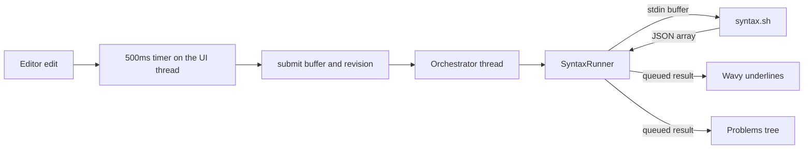

# Check diagnostics: design notes

This document records how external checking works and why it is built this way. It is written for a later refactor: several choices look arbitrary from the code alone.

User-facing behavior is described in [README.md](../README.md) and the `syntax` key in [commands.md](commands.md). This file is about the implementation.

## Goals that drove every decision

1. **The editor does not grow a parser or a language server.** The project already dispatches tools from its `.crlf` files: menu commands, and the formatter script that reads the buffer and writes text back. Checking is the same idea. The script owns clang, eslint, or anything else. The editor owns the contract and the drawing.
2. **Unsaved edits are what get checked.** The buffer is standard input. `${file}` names the language and the include directory. A tool that opens `${file}` checks the saved copy.
3. **A stale column is worse than a brief gap.** An edit clears marks immediately. A result is applied only when it still belongs to that buffer.
4. **Happy-path code.** The JSON array is the one place a check's output is read, because that output is not deterministic. The lexer, the menu runner, and the output log are left alone.

## Components

| File | Role |
| --- | --- |
| `io/ProjectCommands.*` | The `syntax` key: `enabled`, `command` (a string, or a `windows` and `wsl` pair), `cwd`, `watch` |
| `editor/Diagnostic.*` | The span struct and `diagnosticsFromJson` |
| `app/SyntaxRunner.*` | One short process per editor. Stdin is the buffer, stdout is the array |
| `editor/CodeEditor.*` | 500ms timer, wavy underlines, gutter squares, hover tip |
| `app/ProblemsPanel.*` | Directory, then file, then span |
| `app/BottomPanel.*` | Problems page beside Output and Terminal |
| `app/MainWindow.*` | Applies the project settings, starts a check, files the result |
| `app/TabWorkspace.*` | Forwards editor signals, drops a closed tab's rows, jumps to a row |
| `scripts/syntax.sh` | Linux example: clang, csc or the .NET SDK, and `node --check`, each when that tool is installed |

## Why it is not a menu command

`"output": "editor"` replaces the buffer. `CommandRunner` is one long-lived process per command name, and its merged output is a log on the Output page. A check is one short process per editor, replaced after the buffer has been idle, and its stdout is data. Folding it into the menu runner would mix a side channel with command logs.

`SyntaxRunner` still starts the process the same way `CommandRunner::launch` does. A normal Windows directory goes through `cmd.exe`. A working directory under `\\wsl.localhost` or `\\wsl$` goes through `wsl.exe` and `bash -lc`, and path variables are Linux paths. The wrapper prints `CRLF_PGID:` so Stop can end the Linux process group; that line is stripped before the JSON is read. Standard input is closed after the buffer is written, so a script that reads until EOF finishes. Channels stay separate: stdout is the array, stderr is the failure text.

## The contract

Stdout is a JSON array of `{line, column, endLine, endColumn, severity, message}`. `line` and `column` are 1-based, matching `${line}` and `${column}`. A missing end runs the mark from `column` through the end of the line. A present `endColumn` is exclusive: it is the first column not included. `severity` is `error` or `warning`; anything else is drawn as an error.

Messages contain colons, so a `file:line:col` interchange breaks. The app already parses JSON for the `.crlf` files.

Exit 0 means the tool ran and the array is the result, including `[]` for a clean file. Any other exit, or stdout that is not a JSON array, leaves the current Problems rows alone and puts the error on the status bar. Clang and eslint use a nonzero exit to mean "found problems". That is the script's concern: `scripts/syntax.sh` exits 0 after it has written the array, and exits 1 only when the compiler is missing or fails outright.

`diagnosticsFromJson` skips entries that have no line or column. That is the boundary check for tool output.

## Marks

`Highlighter` is the lexical authority. It knows strings, comments, and fold depth, and a rehighlight wipes formats it applied. Find matches and the Ctrl+hover link already live in `CodeEditor::highlightCurrentLine` as extra selections, because updating those selections from inside `contentsChange` reenters the document. Diagnostic spans join that list, with `QTextCharFormat::WaveUnderline`. The underline color is `diagnosticError` or `diagnosticWarning` from the theme; a theme that omits them keeps the terminal red and yellow.

The gutter square is painted in `paintGutter` for each visible line a span covers. An error on a line wins over a warning.

Hover shows the message with `QToolTip` when the pointer is inside a span and Ctrl is not held. Ctrl+hover stays the definition link.

An edit clears the spans in that handler and queues the overlay refresh. It restarts the 500ms timer and does not cancel the process that is in flight. The timer stays on the editor, on the UI thread. It does not start a process itself. When 500ms pass with no further edit, the UI submits the buffer and the document revision. If a check for that editor is still running, the orchestrator replaces it: the kill runs on the orchestrator thread and does not wait. The replacement starts from that process's finished handler on the same thread.

The timer is 500ms, not the symbol scan's 200ms, because a symbol scan is a memory read and a check starts a process. Each editor has its own timer and its own process, so switching tabs does not cancel another buffer. `QTextDocument::revision()` is recorded when the check is submitted and compared when the result is applied, so a result that belongs to an older buffer is dropped. The editor also has to still be open.

`setSyntaxEnabled(true)` starts the same timer after the text is in the editor, which is the first-load check. An external reload calls `replaceText`, and that edit restarts the same timer. Paste and a format that replaces the buffer do too.

The hex view has no text buffer and is not checked. Closing a tab, or swapping the tab to hex, submits a cancel and removes that file's rows.

Cancellation closes the kill-on-close job, calls `QProcess::kill()`, and starts the WSL process-group kill without waiting for it. None of that runs on the UI thread. See [processes.md](processes.md).

## Problems

Output is a command log. Problems is a tree: directory, then file name, then one row per span, in the order the script wrote them. Directories and files are ordered by path.

The directory is the path relative to the project root when the file is under it. A file in that directory is grouped under `.`. Anything else uses the absolute directory. A buffer with no path is grouped under `(unsaved)`, and its key is the editor id so two untitled tabs stay distinct. A later save moves the rows to the new path without opening the strip.

A finished check replaces the rows for that file. `[]` removes the file, and a directory with no files is removed. Activating a row focuses the open editor and calls `CodeEditor::goTo`. Rows are only kept for editors that are open.

The page opens when a check returns one or more spans and the strip is hidden. An update while Output or Terminal is showing refreshes the tree and leaves the current page, so a running terminal is not displaced. The button label includes the span count. Closing the strip hides it and does not stop checking.

## The shipped script

`scripts/syntax.sh` is the Linux example of the contract, parallel to the formatter. `.c` runs `clang -fsyntax-only -x c`. The C++ suffixes the formatter already lists run `clang++ -fsyntax-only -x c++`. `.cs` uses `csc` when it is on `PATH`, otherwise the newest SDK's `csc.dll` through `dotnet`, with the `Microsoft.NETCore.App.Ref` pack referenced when that pack is installed. `.js`, `.mjs`, and `.cjs` use `node --check`. When `node` or a C# compiler is not installed, those extensions print `[]` and exit 0. A missing `clang` or `clang++` still exits 1, because that is the C and C++ toolchain this script requires. Every other extension prints `[]` and exits 0. Adding a language means extending the script, not the editor.

Stdin is copied to a temp file because clang will not resolve `#include "sibling.h"` from a buffer. Quoted includes are searched in the compiled file's directory first, and that file is in the temp directory, so the script passes `-I` set to `dirname` of the path argument. `-fno-color-diagnostics` and `-fno-caret-diagnostics` keep the text to `file:line:column: severity: message`. Notes and caret lines are ignored. `fatal error` is reported as `error`. Clang exiting 1 because it found problems still exits 0 from the script.

The command runs inside the distro whenever `cwd` is a `\\wsl.localhost` path, so the script path has to be one that distro can execute. `scripts/syntax.sh` from the project directory is the documented form. The file is also shipped beside the program, under `scripts/`, and `"${programDir}/scripts/syntax.sh"` names that copy; inside a distro the variable is a `/mnt/<drive>/...` path.
