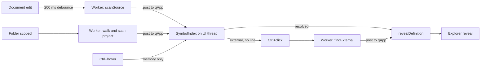

# Definition navigation: design notes

This document records how Ctrl+hover / Ctrl+click definition navigation works and why it is built this way. It is written for a later refactor: several choices look arbitrary from the code alone, and some of them exist to avoid crashes or UI stalls that are hard to rediscover.

User-facing behavior is described in [README.md](../README.md) and the `.crlf` keys in [commands.md](commands.md). This file is about the implementation.

## Goals that drove every decision

1. **Hover never blocks.** Ctrl+hover runs on the UI thread on every mouse move. It may only read memory (hash lookups and one short regex over the current line). No disk access, no scanning.
2. **Disk work happens off the UI thread**, on `QThreadPool::globalInstance()`, and posts results back.
3. **Low memory and CPU.** Index only names and positions, not file contents. Read external files one at a time, with hard caps.
4. **Data-driven languages.** What counts as a declaration lives in the language JSON files (`resources/languages/*.json`), not in C++ per language. C++ only holds behavior that patterns cannot express (imports, stylesheet keys, Tailwind, external lookup).
5. **Happy-path code** per the project rules. Validation exists only where input is not deterministic: files on disk, `package.json`, and user documents.

## Components

| File | Role |
| --- | --- |
| `syntax/SyntaxTypes.h` | `SymbolRule`: one declaration regex with `capture`, `local`, `params`, `prefix` |
| `syntax/LanguageDefinition.*` | Parses `symbols`, `modules`, `stylesheet`, `classAttributes`, `ignoreCase` |
| `syntax/SymbolScanner.*` | Pure function `scanSource(text, definition, includeLocals)`. Blanks comments and strings, runs symbol rules, parses import and export bindings. No Qt objects and no I/O, so it is safe on any thread |
| `editor/SymbolIndex.*` | UI-thread index of every scanned file ("slice"), the name map, and import resolution. Starts background scans |
| `editor/ImportAliases.*` | Reads `tsconfig`/`jsconfig` `paths` and Vite `resolve.alias` for directory aliases such as `/@utils` |
| `editor/SymbolLocation.h` | The result type: a resolved position, or an unresolved external target |
| `editor/TailwindNames.*` | Maps a Tailwind class to the theme variables it reads |
| `editor/ExternalLookup.*` | Click-time search under `node_modules`. Runs only on a worker |
| `editor/CodeEditor.*` | Picks the name under the pointer, asks the index, draws the underline, and emits the click |
| `app/TabWorkspace.*` | Owns the index, opens the target tab, starts and cancels external lookups |
| `app/ExplorerPanel.*` | `reveal(path)` selects the opened file in the tree |
| `io/ProjectCommands.*` | `.crlf` keys `navigation` and `externalNavigation` |

## The index

### Slices

Each scanned file is a `Slice`: hits (name, line, column, local flag), module bindings, and the default export. Slices are keyed by absolute path, or `untitled:<editor pointer>` for an unsaved buffer.

- **An open buffer replaces the disk slice for the same path.** The editor's text is newer than the file, so `bufferOwns` blocks a later disk scan from overwriting it.
- **Closing an editor rescans that path from disk** if it is inside the project (`releaseKey` → `scheduleDiskFile`), so unsaved edits stop counting.
- **`rebuild()` regenerates the name map from all slices** after every change. That is a full rebuild, chosen for simplicity: the map holds only positions, and rebuilds happen on scan results, not on hover. Make it incremental if profiling shows a cost on large projects.

### Generation counters

Every async scan carries a generation number (`m_walkGeneration`, `m_fileGeneration[path]`, `m_bufferGeneration[editor]`). A result whose generation is no longer current is dropped. This is what makes debouncing and rescoping safe without locks: the index is only touched on the UI thread, and stale results simply do not apply.

### Posting back: `QCoreApplication::instance()`, not `this`

Workers post results with `QMetaObject::invokeMethod(QCoreApplication::instance(), lambda, Qt::QueuedConnection)` and check a `QPointer<SymbolIndex>` **inside** the lambda.

Posting to `alive.data()` after checking the pointer on the worker is a race: the GUI thread can destroy the index between the check and the call. That caused a SIGSEGV when closing the app under the debugger. The application object outlives the window, so posting to it is always safe, and the `QPointer` check runs on the UI thread where destruction also happens.

Do **not** replace this with `QThreadPool::waitForDone()` at shutdown. It waits for the whole global pool (other features use it) and can deadlock if a task posts back to the UI thread.

`CodeEditor::~CodeEditor` disconnects its own queued connections and removes its buffer before its document is destroyed, for the same reason.

### Project walk

- Starts when a folder is scoped (`MainWindow::applyProject` → `TabWorkspace::setSymbolProject`).
- Skips dot directories, `.crlf` `hide` patterns (matched exactly like `ExplorerPanel`: case-insensitive, wildcard when the pattern has `*` or `?`), any `node_modules` directory, and files over 1 MiB.
- **`node_modules` is always skipped, even when not hidden.** It can contain hundreds of thousands of files. External code is resolved on click instead (see below).
- Disk scans pass `includeLocals = false`, so local variables from files you are not editing are never stored.

### Lookup order in `find`

1. **An import in the current file wins.** A name bound by `import` resolves through that module, never to a same-named symbol elsewhere. Duplicate import and declaration is invalid JavaScript, so this cannot hide a real local.
2. **A package import is external**, even when a project file happens to declare the same name. Otherwise `useState` could jump to an unrelated project function.
3. **A hit in the current file**, preferring project-level declarations over locals.
4. **The original side of an aliased import.** In `import { AlertDialog as AlertDialogPrimitive }`, `AlertDialog` is not a binding in this file, but clicking it should open the export. This runs after the current-file check so a real local declaration of the same name still wins.
5. **Any other file's project-level hit**, same file first.

`object.member` goes through `findMember` first. A default or `* as` import resolves the member as an export of that module. A **named** import may itself be a namespace: Base UI publishes `export * as AlertDialog from "./index.parts.mjs"`, so `AlertDialogPrimitive.Root` must search `Root` inside `index.parts`. For a package this is sent to the worker as `name = Root`, `container = AlertDialog`.

The token under the pointer is skipped (`skipLine`/`skipColumn`). A declaration is not a link to itself when it is the only hit.

## Scanner

### Blanking comments and strings

`blankNonCode` replaces comment and string characters with spaces and **keeps newlines**. Offsets therefore still map to the original line and column, so a regex can run over code-only text and report real positions without a separate mapping table.

The module scan is the exception: it blanks comments only, because import specifiers are inside quotes. A `covered()` check then rejects an `import` keyword that was itself inside a string or comment in the fully blanked text.

### Symbol rules

- **Rule order matters.** Hits are deduplicated by name, line, and column, and the first rule wins. Project-level rules (for example PascalCase `function`/`const` for React components) must come **before** the `local` rules, or a component would be stored as a local and become invisible to other files.
- **`local: true`** keeps a hit in the open document only. Variables such as `i` must not jump across files, and storing every local from the whole project would cost memory for no benefit.
- **`params: true`** means the capture is a parameter list. The scanner splits on commas, drops `= default`, `: type`, and `...`, and takes the last identifier. This replaced writing a per-language parameter scanner.
- **Keyword captures are rejected** with the language's keyword regex. Type names from `types` are **not** rejected: a TypeScript variable named `string` is legal.
- **`prefix`** is prepended to the captured name. Sass mixins and keyframes are stored as `@name` so they never share a key with a script identifier.

### PCRE2 constraint

Qt's `QRegularExpression` (PCRE2) rejects an unbounded variable-length lookbehind such as `(?<![<,]\s*)` ("length of lookbehind assertion is not limited"). Use a bounded form: `(?<![<,]\s{0,40})`. The C++ class rule uses this to skip `template<class T>`. The Sass selector rule uses `(?<!:\s[^\n]{0,120})` to skip declaration values such as `color: #fff`.

### Import bindings (`modules: true`)

`ModuleBinding` covers `import X`, `import { A as B }`, `import type`, `import * as ns` (`whole`), `export { } from` (`reexport`), `export * as ns from` (`reexport` + `whole`), and `export *` / `export type *` (`star`). The default export records its name, or the `export default` position when anonymous.

A `whole` binding names a module, not a declaration, so resolving it opens that module at line 1. `lookupExport` must never treat a `whole` re-export as the default export: both have an empty `imported`.

Component libraries commonly publish compound components this way (`export * as Dialog from './index.parts'`). Without `export * as`, those names cannot be found at all.

- `export { Foo as Bar } from` is captured without braces by the regex, so the code wraps it in `{...}` before parsing to reuse the same clause parser.
- `Default, * as ns` is split on commas before braces, so both names are bound.

## Resolving specifiers

- **Relative** (`./`, `../`): tries the path as written, then the extensions `.tsx .ts .jsx .js .mts .cts .mjs .cjs`, then `index.*`. Returns a path only when a slice for it exists, so resolution is a memory lookup.
- **An exact slice match is tried first.** That is what lets `./App.module.css` resolve to a stylesheet.
- **Directory aliases** (`ImportAliases`): `tsconfig`/`jsconfig` `paths` (with `extends`, comments, and trailing commas), Vite `resolve.alias`, then a guess for `/@dir/...`, `@dir/...`, and `@/...` under the project root and `src`. The longest prefix wins. The aliases are cached per directory of the importing file and recomputed only when that changes.
- **Anything that resolves to no project file is a package.** Scoped packages (`@mui/material`) also go through the alias guess first, fail it, and become external. That is intended.

## Stylesheet navigation

### Keys

Stylesheet names share the project name map with script identifiers, so they carry their sigil:

| Source | Key |
| --- | --- |
| `.btn` selector, `class="btn"`, `className`, class helper string, `@apply btn` | `.btn` |
| `#main` selector, `id="main"` | `#main` |
| `--brand` | `--brand` |
| `$gap` | `$gap` |
| `@mixin`, `@function`, `@keyframes`, Sass `=mixin` | `@name` |
| `@utility tab` (Tailwind 4) | `.tab` |

Without the sigil, a JavaScript variable `container` would jump to a `.container` rule.

### Where a name is read

`CodeEditor::linkKeyFor` decides the key from context on the current line:

- In a stylesheet (`"stylesheet": true`), `-` is part of a name and the character before decides the key (`.`, `#`, or `@` for an at-rule keyword, which is not a link).
- In markup (`"classAttributes": true`, HTML and TypeScript), `attributeAt` finds the quoted string under the pointer and checks the text before it. Class contexts are `class=`, `className=` (including `{...}` expressions), and the helpers `clsx`, `cn`, `cx`, `cva`, `tv`, `twMerge`, `twJoin`, `classNames`, and a `tw` template tag. It is single-line on purpose: it must stay cheap on hover. Multi-line `cn(...)` arguments on their own line are a known gap.
- A word followed by `:` inside a class string is a Tailwind variant and becomes `--breakpoint-<word>`.

### Which unresolved names count as external

Only references, never definitions:

- A markup class with no project definition (a library class such as Bootstrap's `btn`, or a Tailwind utility).
- `var(--x)`, `$x` that is not followed by `:`, `@include x`, `@extend .x`.

A selector in a stylesheet is itself a definition, so an unmatched selector is plain text. Otherwise every unique selector would look external.

### CSS modules

`styles.card`, where `styles` is a default import of a `.css/.scss/.sass/.less` file, resolves `.card` in that file, then the kebab-case form `.card-title` for `cardTitle` (the common `localsConvention`). This shares `SymbolIndex::findMember` with script namespace members.

### Tailwind

Tailwind utilities are generated, so they have no selector in the project. `parseTailwindClass` strips variants (`hover:`), `!`, a leading `-`, and `/opacity`, matches the longest known utility prefix, and lists the theme variables that utility reads (`bg-brand-500` → `--color-brand-500`; `p-4` → `--spacing-4`, then `--spacing`).

- Hover checks those variables in the project index, which finds a project `@theme` block.
- A click searches the `tailwindcss` package. Version 4 ships `index.css` that imports `theme.css`, where the defaults live. The package is searched even when the document does not import it, because a TSX file never imports Tailwind directly.
- Tailwind 3 has no CSS variables, so the fallback searches `tailwind.config.*` (walking up to the nearest `package.json`), then the package's `colors.js` and `stubs/config.full.js`, for the theme key.
- Utilities with no theme value (`flex`) underline as external but resolve to nothing. Making them plain text would require Tailwind's full utility list.

The prefix table lives in C++ (`TailwindNames.cpp`), not JSON, because it describes Tailwind's own naming, not a file syntax.

## External navigation

### Hover marks, click resolves

Hover produces a `SymbolLocation` with `external = true` and `line = 0`. It costs no disk access. `ExternalKind` says how the click resolves it:

- **Package:** a name imported from a package, or a member of a default or `* as` import (`React.FC`, `z.infer`). `wholeModule` opens the package entry for the namespace name itself.
- **Stylesheet:** a stylesheet key with no project definition.
- **Global:** a PascalCase name with no definition and no import (`HTMLDivElement`, `Promise`, `JSX.Element` with `container = JSX`). PascalCase plus at least one lowercase letter excludes constants such as `MAX_SIZE`. A member of a project symbol (`Color.Red`) is never global.

External links draw the text and the underline in the theme's function color, so the user can tell before clicking that a package file will open.

### The click worker (`findExternal`)

- **Package lookup:**
  - Find the nearest `node_modules/<pkg>` walking up from the file.
  - Read `package.json` and collect entry files: `exports` conditions (`types`, `import`, `module`, `default`, `require`, `node`, `browser`), then `types`, `typings`, `module`, `main`, `index`. A script path tries its declaration sibling first: `.js` → `.d.ts`, `.mjs` → `.d.mts`, `.cjs` → `.d.cts`. ESM-first packages such as Base UI write `from "./index.parts.mjs"` inside `.d.mts` files, and only the `.d.mts` file holds the types.
  - Append `@types/<pkg>` entries.
  - Scan each file with the TypeScript definition. Prefer project-level hits, then local hits, then a declaration regex. Follow relative `export ... from` and `export *` up to depth 4.
- **Stylesheet lookup:** the packages the document imports (JS imports, side-effect imports, `require`, `@import`/`@use`/`@forward`, `~` stripped), plus `tailwindcss`. For each package, use the subpath file or the `style`/`sass` fields, and follow relative stylesheet imports and Sass partials (`_name.scss`, `_index.scss`).
- **Global lookup:** files in priority order: `@types/react`, TypeScript `lib.dom.d.ts` and `lib.es5.d.ts`, `@types/node`, the remaining `lib.*.d.ts`, then every other `@types` package. Follow `/// <reference path>`. A file is matched with regexes only after a plain `contains(name)` check, so most files cost one read and no regex.

### Limits

| Limit | Value | Why |
| --- | --- | --- |
| File size, source and stylesheets | 1 MiB | Same cap as the project walk; avoids minified bundles |
| File size, declaration files | 8 MiB | `lib.dom.d.ts` is larger than 1 MiB |
| Files per package or stylesheet click | 24 | Enough for re-export chains and partials |
| Files per global click | 120 | Many `@types` packages and `lib` files |
| Packages tried for a stylesheet name | 8 | The document's own imports |
| Re-export / import depth | 4 | Stops cycles and deep barrels |

Only one file is held in memory at a time. Results are positions, not text.

### Cancellation

`TabWorkspace` keeps a `QSharedPointer<QAtomicInt>` generation. Each click increments it. The worker's `Budget::take` checks it before every file read, so a newer click stops an older lookup between files, and a stale result is dropped on arrival.

### pnpm

pnpm links direct dependencies into `node_modules/<pkg>` as junctions (symlinks on some setups). Windows and `QFileInfo` follow these like folders, so no special handling is needed for them. Packages that are not direct dependencies, often `@types/react`, exist only under `node_modules/.pnpm/node_modules`, so `packageDirectory` and `typesRoots` also check that folder at each level.

### A crash that must not come back

`exportTarget` reads `exports` conditions recursively. It must return when a value is not a string, array, or object. An earlier version called `toObject()` on an undefined value and recursed on its missing keys forever, overflowing the worker's stack on common packages such as React. Any rewrite of the `package.json` reader needs the same type check.

## Settings

| `.crlf` key | Default | Effect |
| --- | --- | --- |
| `navigation` | `true` | `false` clears the index, stops all scans, and makes `find` return nothing. Turning it back on rescans the open editors and the project |
| `externalNavigation` | `true` | `false` makes package imports, unresolved stylesheet names, and global names plain text. The click worker never runs, so `node_modules` is never read. Project links still work |

Both are read in `projectFor` and applied in `MainWindow::applyProject`.

## Opening the target

`TabWorkspace::revealDefinition` reuses an open tab when the target is open, by editor pointer or path. Otherwise it loads the file on a worker and opens a tab. `CodeEditor::goTo` unfolds any fold hiding the line and centers it. When the target is in a different file than the current tab, `fileRevealed` makes the explorer expand the parents and select the file. The explorer waits for each folder's asynchronous listing before descending, and gives up quietly when the file is outside the scoped folder or hidden.

## Known gaps

- External navigation is TypeScript and JavaScript only. C++ headers, Python `site-packages`, and .NET assemblies are not searched.
- Class strings in a multi-line `cn(...)` call are recognized only on the line that holds the call or the `className`.
- Tailwind utilities without a theme variable resolve to nothing. Functional `@utility name-*` definitions are not matched to their classes.
- `rebuild()` is a full rebuild of the name map.
- Global names declared in a project `declare namespace` are not indexed (there is no `namespace` symbol rule).
- Hover detection is regex-based per line. Unusual formatting can miss a link. That is accepted in exchange for zero parsing cost.
