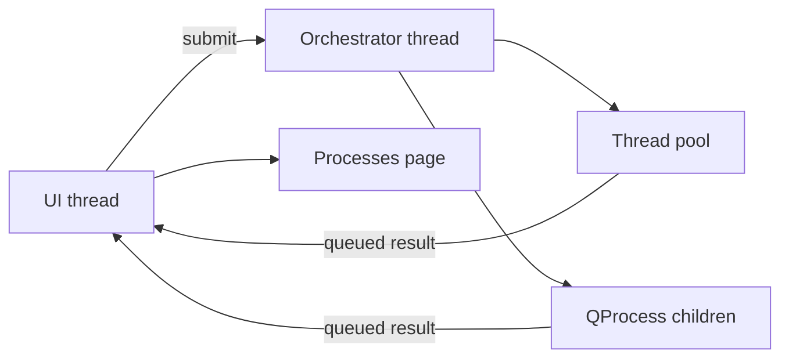

# Process orchestrator: design notes

This document records where work runs, and why the UI thread does not. It is written for a later refactor: the stall that motivated it (a check cancel calling `waitForFinished` on `wsl.exe` from the editor) is easy to reintroduce one feature at a time.

User-facing behavior for checks is in [diagnostics.md](diagnostics.md). This file is about the threading rule.

## The rule

Widgets, the text document, and painting stay on the UI thread. A child process, a `waitForFinished`, a directory walk, a file read, or a symbol scan does not.

The UI thread may start a debounce timer and call `ProcessOrchestrator::submit`. That call queues onto the orchestrator thread and returns. The finished signal is delivered back to the UI thread, and only that slot writes editor marks, the Problems tree, command output, the symbol index, or the explorer model.

`QProcess` objects live on the orchestrator thread. `SyntaxRunner` and `CommandRunner` are moved there with `moveToThread`. Their signals connect with `Qt::QueuedConnection`. `WslPath::run` blocks inside `wsl.exe`; it is only called from orchestrator work, including the folder picker and the distro list.

A new feature that can run off the UI thread gets a record and a `submit`. It does not construct a `QProcess` or call `QThreadPool::globalInstance()` itself.

## Records

`submit` takes a key, a name, an owner (tab title and path, or a folder), a debounce interval, a detail string, and the function to run. The record is `Sleep` while the debounce timer is waiting and `Running` while the pool task or child process is in flight. Completion or cancellation removes it.

The Processes page receives a copy of the records. It never reads the worker's memory. View > Processes opens that view as one editor tab. Choosing it again focuses the same tab. Closing the tab does not stop the work.

The page has three sections. Active lists live records. History lists the last 20 that finished or were cancelled. Log shows the log of the row last selected in either list. Double-clicking a row opens Log. A live task that finishes keeps its log on screen as its History row. A script writes the log on standard error; standard output stays the protocol (the check array, or one completion reply per line). The last 2,000 lines are kept. `"unlimitedLog": true` at the top of an object-shaped `.crlf` file keeps every line instead. Array-shaped files leave the cap on. A finished task's log moves to its History row whole, so set the key before reproducing a noisy problem. New lines are appended to the view, and it stays where it is when you have scrolled up.

A standard error line that starts with `CRLF_STATUS:` is not logged. The rest of the line becomes the record's Activity, such as `servers: 2 ready`, until the next one. `ProcessOrchestrator::setActivity` sets it from C++.

Cancel and Reload act on the selected Active row. `MainWindow` routes them by key:

| Key | Cancel | Reload |
| --- | --- | --- |
| `autocomplete` | Stops the autocomplete session | Starts the session again, replacing the running one |
| `syntax:<editor>` | Stops that editor's check | Checks the editor's current text again |
| `command:<name>` | Stops the menu command | Runs the command again, as choosing it from the menu does |
| `git:<n>` | Stops that git job. The repository's next queued job starts | Not offered |
| `agent` | Stops the agent. The next message starts it again | Starts a new session with an empty transcript |
| `agent-terminal:<id>` | Stops a command the agent is running. The agent reads its exit | Not offered |
| Anything else | Drops the record. A pool task already running keeps going, and its result is no longer the current one | Not offered |

Reload starts the command string again, so an edited script is read from disk. Nothing watches the script.

Restart Services, on Active, needs no selection. It starts autocomplete again and checks every open editor, for whichever of the two the project enables. Those are the processes that run without being chosen from a menu, so this brings them back after a Cancel. Menu commands are left alone, and so is the agent, because a new session ends the conversation.

`ProcessLaunch` is the one place a child process is started: `cmd.exe`, `bash` inside a distro, or a program with plain arguments, each inside a kill-on-close job. `CommandRunner`, `SyntaxRunner`, `JsonLineProcess`, `AgentTerminals`, and `GitClient` each hold one per process. `JsonLineProcess` is the long-lived process that reads and writes one JSON object per line; the autocomplete session and the agent are each one. Stopping a process closes the kill-on-close job and calls `QProcess::kill()` on the orchestrator thread. It does not wait. The WSL process-group kill is started there and not waited on. A replacement check starts from the `finished` handler on that same thread.

## What runs where

| Work | How it is submitted | What stays on the UI thread |
| --- | --- | --- |
| Syntax check | `SyntaxRunner` on the orchestrator thread, after the editor's 500ms idle timer | `MainWindow::applySyntax` draws marks and updates Problems |
| Completion | `CompletionSession` on the orchestrator thread. The process stays up; each request is one JSON line | `MainWindow::applyCompletion` fills the popup |
| Menu command | `CommandRunner` on the orchestrator thread | Output chunks and exit state, which the Output page already displays |
| Agent | `AgentSession` on the orchestrator thread. The process stays up; it speaks JSON-RPC, one object per line. See [agent.md](agent.md) | `AgentHost` answers the agent's requests; `AgentPanel` draws the transcript |
| Agent command | `AgentTerminals` on the orchestrator thread, one process per `terminal/create` | The Output log `agent: <command>` |
| Agent file read or write | Pool, for a file that is not open | An open file's text, and its replacement |
| Symbol scan | Pool. The editor's 200ms timer is the `Sleep` record | `applyDisk` and the index update |
| External lookup and opening a definition | Pool | Opening the tab |
| Explorer listing | Pool. The first read of a folder is a History row; reading it again is not, because that repeats on its own | The model update: the first read fills the folder, a later read changes only the rows that differ |
| Explorer changes on disk | `FolderWatch`: one Windows directory handle on the scoped folder, reporting its whole subtree to the UI thread. Each folder it names is read again on the pool 200ms later. A WSL share reports nothing, so its listed folders are read again every 3 seconds while the explorer is showing and the window is in front | Gathering the folder names, and the model update |
| Open file, restore session, `projectFor` | Pool | Applying the text or the project |
| First-run copy of `application.crlf`, the legacy `.crlf` rename | Pool, in the same task as `projectFor` | Retargeting an open tab and the status bar message |
| Saving `groups` or `icons` into a workspace file, Copy Application Files to Workspace | Pool | The dialog, the status bar message, and the reload |
| `WslPath::distros` and `home` | Orchestrator thread, before the folder picker reads the names | The dialogs |
| git status, operations, and object reads | `GitClient` on the orchestrator thread, one job at a time per repository. See [git.md](git.md) | `SourceControl` keeps each status; the panel, explorer, and status bar redraw from it |
| Repository search, the Diff tab's diff | Pool | Applying the repositories, opening the tab |
| Change bars | Pool. The editor's 300ms timer is the `Sleep` record | `CodeEditor::setChangeMarks` |

The 500ms check timer stays on the editor. It does not start a process by itself.

- **First load.** `setSyntaxEnabled(true)` starts the timer after the text is in the editor.
- **External change.** `reloadExternal` reads the file on the pool, then `replaceText` restarts the same timer.
- **Typing has finished.** `contentsChange` clears that editor's marks and restarts the timer. It does not cancel a running check. When 500ms pass with no further edit, the UI submits the buffer and the revision.

A result is applied only when the editor is still there and the document revision matches. Closing a tab or switching it to hex submits a cancel.
